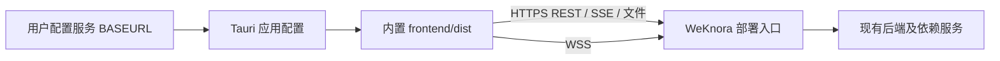

# Tauri 2 远端服务桌面端开发方案

状态：待实施。日期：2026-11-20。

## 1. 已确认的范围

桌面端使用 Tauri 2 打包仓库现有的 `frontend/`，连接用户指定的 WeKnora 标准部署服务。桌面程序只负责窗口、连接配置和必要的系统集成；数据、鉴权和业务能力仍由远端服务提供。本文不包含内嵌 Go 服务、SQLite、本机沙箱或本地模型运行时。

**服务 BASEURL 是运行时配置项**，不是写死在 Vite 构建中的 `VITE_BASE_PATH`。同一个安装包可以连接不同部署。用户填写的是对客户端开放的部署入口，例如 `https://weknora.example.com`，而不是内部容器地址、`/api/v1` 接口地址或前端静态资源目录。

| 地址 | 示例 | 用途 |
|---|---|---|
| 服务 BASEURL | `https://weknora.example.com` | 用户保存的连接配置 |
| REST API | `https://weknora.example.com/api/v1` | 登录、知识库、会话等请求 |
| 其他服务路径 | `https://weknora.example.com/files`、`https://weknora.example.com/mcp/` | 文件和 MCP 请求 |
| WebSocket | `wss://weknora.example.com/api/v1/...` | 终端、桌面沙箱等实时连接 |

部署在子路径时，BASEURL 可为 `https://example.com/weknora`，路径拼接遵循现有的 [子路径部署约定](../subpath-deployment.md)。服务入口须正确转发 `/api/`、`/files`、`/mcp/` 及 WebSocket 请求。正式环境优先使用 HTTPS。

## 2. 仓库现状与改造点

| 位置 | 当前行为 | 桌面端改造 |
|---|---|---|
| `frontend/package.json`、`frontend/vite.config.ts` | Vue 3 + Vite 构建 SPA，默认资源基路径为 `/` | 复用同一份源码和 `dist`，增加 Tauri 开发与打包命令 |
| `frontend/src/utils/api-base.ts`、`frontend/src/utils/request.ts` | API 地址按前端资源基路径解析，常规部署依赖同源代理 | 区分“前端资源基路径”和“远端服务 BASEURL”；Axios 使用后者 |
| `frontend/src/api/chat/streame.ts` 等 | SSE 请求自行拼接 URL | 使用统一的远端 HTTP 地址解析函数 |
| `frontend/src/composables/useSandboxTerminal.ts`、`useSandboxDesktop.ts` | WebSocket 地址取 `window.location.host` | 从服务 BASEURL 生成 `ws` 或 `wss` 地址 |
| `frontend/src/utils/protectedFileAccess.ts`、`security.ts` | 受保护文件及图片存在相对地址和独立 `fetch` | 将服务资源地址指向远端，同时保留现有鉴权头和租户头 |
| `frontend/src/router/index.ts` | history 路由，未登录时会尝试一次 Lite 自动初始化 | Tauri 模式直接进入普通登录流程；验证硬刷新和路由恢复 |
| `frontend/src/views/auth/Login.vue` 等 | OIDC、OAuth 和邀请链接部分以页面 origin 推导地址 | 明确远端公开地址与桌面回跳流程，不把 Tauri 页面 origin 传给服务端 |

`getApiBaseUrl()` 当前还用于登录跳转等前端路径。不能简单地将其返回值整体改成远端 URL；应建立用途明确的解析函数，例如 `frontendBasePath()`、`serviceURL(path)`、`serviceWebSocketURL(path)`，并逐个迁移调用点。Web 版保持当前同源逻辑。

## 3. 推荐架构

工程放在 `frontend/src-tauri/`：Tauri 的 `frontendDist` 指向现有 `frontend/dist`，开发时 `devUrl` 指向 Vite。Rust 层保持最小，只负责窗口、配置存取、外部链接和必要的桌面协议。Tauri 2 对 Vite 的构建配置见 [官方指南](https://v2.tauri.app/start/frontend/vite/)。

### 3.1 服务地址配置

1. 首次启动展示连接设置页，输入服务 BASEURL。可提供构建时的**默认值**，但默认值不锁定服务器，用户仍能修改。
2. 规范化并校验 URL：仅接受 `http`/`https`，去掉尾部 `/`，拒绝凭据、查询参数和片段；不要让用户填写 `/api/v1`。生产发行版默认要求 HTTPS，开发环境可允许回环 HTTP。
3. 检查服务可达性与接口形状：请求 `${BASEURL}/health` 和公开的 `/api/v1/auth/config`；区分网络失败、证书错误、路径错误与服务返回的业务错误。
4. 校验成功后存入 Tauri 应用配置。前端在路由和首批 API 请求启动前读取该配置。设置页展示当前地址，允许重新检测和修改。
5. 切换服务器时先退出当前会话，清除 token、refresh token、租户选择及内存业务缓存，再加载新地址；不把旧服务器凭据带到新服务器。

配置只保存服务地址，不保存管理员密钥。普通登录凭据继续遵循前端现有认证流程。若今后需要同时保存多个服务器，应按服务器隔离登录态，作为单独需求设计。

### 3.2 请求与资源

HTTP、SSE、WebSocket、文件、图片和下载都应使用统一的服务地址规则。外部分享链接、邀请链接、CLI/API 示例应指向远端公开域名，不能出现 `tauri://` 或 `tauri.localhost`。帮助文档和其他外部网站由系统浏览器打开。

当前服务端 CORS 允许跨域 Bearer 请求，但带 cookie 的跨域请求不能仅依靠 `AllowOrigins: ["*"]`。实现时需逐项验证受保护文件的 `credentials: 'include'`、OIDC nonce/PKCE cookie、第三方 OAuth 弹窗和下载行为；必要时改为明确的允许源或调整桌面认证流程。Tauri 权限只授予内置页面实际需要的命令，不向远端网页开放原生能力；参见 [Tauri capabilities](https://v2.tauri.app/security/capabilities/)。

### 3.3 登录与回调

普通账号密码登录、令牌刷新和登出作为第一阶段的登录闭环。OIDC/OAuth 当前依赖浏览器页面 origin 和服务端回调 URL，需单独实现系统浏览器登录、服务端回调及桌面安全回跳。可研究 Tauri [deep link](https://v2.tauri.app/plugin/deep-linking/)，但最终协议必须避免把长期令牌直接放进 URL，并与服务端现有回调配置兼容。完成这部分前，不能宣称桌面端与 Web 端登录能力完全一致。

## 4. 实施顺序与验收

1. **建立壳工程**：新增 `frontend/src-tauri/`、构建命令、窗口图标和最小权限配置。验收：开发模式及安装包都能加载内置前端。
2. **连接配置与普通登录**：启动前读取 BASEURL，完成地址校验、保存、修改、登录、刷新和切换服务器清理。验收：同一安装包可先后连接两个测试部署，凭据不串用。
3. **业务链路适配**：统一 HTTP/SSE/WS/资源地址。验收：知识库列表、上传、预览、下载、聊天流式输出，以及已启用的 WebSocket 功能正常工作。
4. **桌面交互与外部链接**：处理外部浏览器、弹窗、下载、硬刷新及应用窗口行为。验收：普通导航不会跳出应用，外部网页不会获得 Tauri 原生权限。
5. **SSO 与发布验证**：完成实际启用的 OIDC/OAuth 回跳方案；在目标 Windows、macOS 环境验证安装、升级、证书、代理网络和断线恢复。

测试应覆盖根路径和子路径部署、HTTPS 证书错误、服务不可达、流式请求中断、切换服务器后的登录态隔离，以及前端 Web 构建回归。桌面端的可用功能以远端部署返回的能力信息为准。
